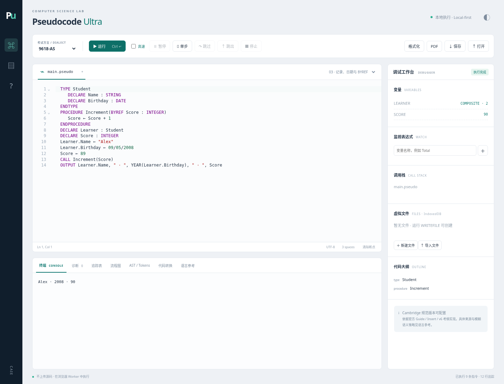

# Pseudocode Ultra

2026-10-24 本机复核与 45 类问题修复见 [本机实测报告](docs/LOCAL_REVIEW_2026-10-24.md)：269 项测试通过；完整初版中的考试、题库、教师与桌面模块仍未全部实现。此次没有重新构建发布产物，官方 PDF 下载复核也未完成，范围与下述初始工程验收不同。

浏览器本地运行的 CAIE 伪代码 IDE。M1–M4 已实现并通过工程验收：0478 / 2210、9618-AS、9618-A2、调试与教学工具，以及 Python / Java / VB.NET 独立源码转换。

TypeScript + CodeMirror 6 + Web Workers，无后台服务、账户或 API key。完整记录见 [验收报告](docs/ACCEPTANCE.md)、[机器验收结果](docs/validation/summary.json) 和 [规范来源](docs/SOURCES.md)。

## 启动

需要 Node.js 22+ 和 npm：

```bash
npm ci
npm run dev
```

`npm run build` 生成 `dist/`，可部署到静态网站服务器；`npm run preview` 检查构建产物。程序在浏览器 Worker 中执行，虚拟文件保存到 IndexedDB，源码、主题与设置保存到 localStorage。同源数据保存在当前浏览器，请下载源码和文件备份。



## 功能

| 阶段 | 已实现                                                                                                                        |
| ---- | ----------------------------------------------------------------------------------------------------------------------------- |
| M1   | 方言配置、Unicode/PDF 字符规范化、带源码范围的词法与 AST、静态语义与双语诊断、基础类型/数组/控制流/子程序、交互 INPUT、编辑器 |
| M2   | Insert 全部内置函数及签名校验、DATE、记录值复制、文本文件、BYREF/BYVAL、完整调用类型与返回路径检查                            |
| M3   | 枚举、指针、集合、随机记录文件、类/继承/构造器/SUPER/访问控制、递归与调用栈、复杂对象图持久化                                 |
| M4   | 断点与单步调试、变量展开与纯表达式监视、追踪表/填空批改/CSV/Excel、模块流程图、AST/Tokens、三语言完整类型与文件模型转换       |

编辑器支持按方言高亮、补全、片段、签名提示、类型和来源悬停、定义跳转、作用域安全重命名、折叠、大纲、快速修复、续行行号和格式化。PDF 按钮打开使用 Courier New 的打印页面，通过浏览器保存 PDF。

转换器直接生成目标语言源码，附带目标语言标准库实现的辅助运行时；支持记录、日期、枚举、集合、指针、类、文本及随机文件，并嵌入当前虚拟文件的初始内容。生成程序使用内存虚拟文件模型。Python、Java、VB.NET 均实际编译或解析并运行，与解释器输出对照。

## 操作

- 切换四种方言，加载七个原创示例。语言参考中可选 Guide 2026 / 2027–2029、严格程度、排版检查、随机种子、运行限制和模糊语义策略。
- Ctrl/Cmd+Enter 运行；遇到 INPUT 在终端提交值。源码修改后，旧运行会停止，避免混用不同版本。
- 点击可执行行旁断点槽或按 F9 设置断点。F11 进入、F10 跳过；工具栏支持暂停、继续、跳出和停止。暂停高亮表示即将执行的语句。
- F12 跳转定义，Ctrl/Cmd+Shift+R 重命名标识符；字符串、注释及无关同名绑定保持原样，可能捕获其他变量的重命名会被拒绝。
- 追踪表可按语句、变化、模块、循环、分支或从左到右规则显示，配置列和重复值；每页 200 行，填空答案跨页保留并按页批改。CSV/Excel 导出所有保留的筛选行。
- 高速模式用于大循环，不记录追踪；需要逐步观察时关闭高速模式。优化器只处理受支持的 AST 子集，其他程序自动回退到解释器。
- 文件面板支持新建、编辑、导入、拖入与导出。监视表达式允许无副作用运算，禁止随机函数、NEW 和用户子程序调用。

## 验收

```bash
npm run setup:toolchains
npm run accept
```

完整验收依次校验 8 份官方资料的 SHA-256，执行核心测试、三语言原生测试、真实 Chromium 测试、类型检查和生产构建、性能基准及构建产物的浏览器 smoke。日志、测试计数、源码摘要和性能结果写入 `docs/validation/`，任一失败都会返回非零退出码。

```bash
npm test                 # 核心、边界、规范、语言服务、1000 组确定性解析器 fuzz
npm run test:native      # Python / Java / VB.NET 编译运行与语义对照
npm run test:e2e         # Chromium 端到端测试
npm run check            # TypeScript
npm run build            # 生产构建
npm run benchmark        # 1000 万次循环、10 万行增量诊断
npm run specs:verify     # 官方资料下载与散列校验
```

原生测试还需要 Python 3、Java 17+ 和 .NET SDK 8。`npm run setup:toolchains` 在 Windows 将 Java 21 JRE、ECJ 3.40 和 .NET 8 SDK 安装到项目 `.tools/`；Linux 保留 `/workspace/.tools` 路径。下载保留 TLS 验证并检查上游校验值，不修改系统目录。可用 `PSEUDO_TOOLS_DIR` 更改安装位置，并设置 `PYTHON_BIN` / `JAVA_BIN` / `ECJ_JAR` / `DOTNET_BIN`。浏览器自动选择本机 Edge/Chrome、系统 Chromium 或 Playwright Chromium，可用 `CHROMIUM_PATH` 覆盖。官方 PDF 默认缓存在项目 `.cache/pseudo-specs`，可用 `PSEUDO_SPEC_CACHE` 覆盖，不随仓库重新分发。

仅检查源码与开发服务器、明确跳过构建时，可使用 `node scripts/acceptance.mjs --no-build --output=docs/review/validation`。若明确追加 `--skip-specs`，结果会记录资料未复核，总状态为 `passed-with-skips`，不等于完整发布验收。

性能基准测量预热后的高速运行，以及完成冷分析后的一次非结构性编辑。冷启动、结构性修改、开启完整追踪的运行不在这两个阈值内。资源上限与精确测试范围见验收报告。

## 目录

```text
core/                  方言、词法/AST、语义、解释器、语言服务、教学工具与转换器
core/native/           Python / Java / VB.NET 原生辅助运行时和文件图快照
web/                   CodeMirror UI、执行/语言 Worker、IndexedDB、PDF 打印
conformance/           核心、边界、规范与教学测试
conformance/native/    三语言原生编译与输出对照
conformance/browser/   Playwright 端到端验收
scripts/               安装、资料校验、性能、完整验收与生产 smoke
docs/                  原始方案、规范来源、验收报告与原始记录
```

M5（考试倒计时、真题起始代码、题库判分、教师端、账户、桌面封装和付费体系）不在本次范围。当前 2210 配置适用于 2026–2028；2029–2031 考纲改用 Python，不沿用本项目的旧版伪代码配置。
