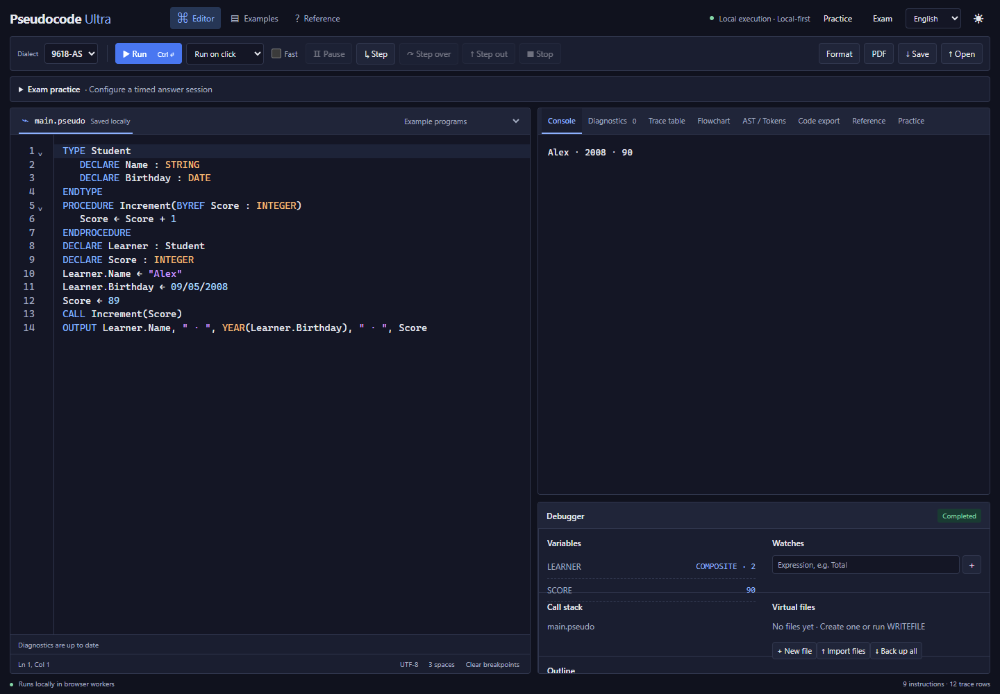

# Pseudocode Ultra

[English](#english) · [简体中文](#简体中文)

<a id="english"></a>

## English

A browser-based pseudocode IDE for Cambridge Computer Science. Write and run code, inspect each execution step, practise with graded exercises, and work through timed exam sessions in one workspace.



### Start locally

Install **Node.js 22 or later** and npm, then run:

```bash
git clone https://github.com/ASH19900601/PseudocodeUltra.git
cd PseudocodeUltra
npm ci
npm run dev
```

Open the address printed in the terminal, usually [http://localhost:5173](http://localhost:5173). Keep the development server running while using the app.

The interface starts in **English**. Choose **简体中文** from the language selector in the top bar to switch languages. The selection is saved in your browser.

### Explore the workspace

| Tool         | What you can do                                                                                                                                                                                                                    |
| ------------ | ---------------------------------------------------------------------------------------------------------------------------------------------------------------------------------------------------------------------------------- |
| Editor       | Use syntax highlighting, completion, snippets, signature help, hover information, formatting, folding, an outline, definition navigation and identifier renaming. Load one of seven example programs or open your own source file. |
| Diagnostics  | See syntax and type errors with source locations and rule references, apply quick fixes, and download the full diagnostic list. Background analysis has progress, cancel and restart controls for large documents.                 |
| Console      | Run programs and enter values interactively when execution reaches `INPUT`. Choose manual execution, run after editing, or run on editor blur.                                                                                     |
| Debugger     | Set breakpoints, pause and continue, step into, step over and step out. Inspect variables, watch expressions and the call stack.                                                                                                   |
| Trace table  | Follow statements and variable changes, filter rows, choose columns, hide repeated values, complete fill-in-the-blank exercises, and export CSV or Excel.                                                                          |
| Flowchart    | View the main program or a selected subroutine as a flowchart and jump from a node to its source line.                                                                                                                             |
| Code export  | Convert the current program to Python 3, Java 17+ or VB.NET and download the generated source. Exports include standard-library helpers and the current virtual-file contents.                                                     |
| AST / Tokens | Inspect the parsed program structure or lexical tokens.                                                                                                                                                                            |
| PDF          | Open a print-friendly source view and save it as PDF through the browser.                                                                                                                                                          |

Choose a dialect in the toolbar: **0478**, **2210**, **9618-AS** or **9618-A2**. The language profiles cover basic types, arrays, control flow and subroutines; AS adds records, dates, text files and parameter modes; A2 adds enums, pointers, sets, random-access files, classes, inheritance and recursion.

For a first run, load **Loops and input**, click **Run**, and enter a value in the console. To inspect execution, set a breakpoint beside an executable line and use the stepping controls. Enable **Fast** for large loops; use regular execution to collect trace rows.

### Practise with automatic grading

1. Open **Practice** in the top bar or output tabs.
2. Choose an exercise and click **Start answering**. Read the task, input/output requirements and two sample cases.
3. Complete the answer in the editor. Use **Run** with sample input to explore its behaviour, then click **Submit for grading**.
4. Review the per-case feedback, revise your answer and submit again. Each exercise has five checks worth 20 points each, for a total of 100 with partial credit.

The ten original exercises cover arithmetic, conditions, loops, array statistics, sentinel values, strings, searching, digit sums, two-dimensional arrays and records. Six use 0478 and four use 9618-AS.

Each exercise retains its draft and the last five submissions, including source and score. Restore a submission to continue editing, use **Retry (keep scores)** to return to starter code, or **Return to previous source** to restore the code and settings from before practice. Grading runs in a separate worker, and its progress can be cancelled.

Grading uses the exercise dialect, strict checking, Guide 2026 and default runtime policies. Follow each exercise's output contract: comparison preserves case and blank lines while accepting trailing spaces and different line-ending encodings.

### Work through a timed exam

1. Open **Exam** and choose the dialect, Guide version for AS/A2, and a duration of **1–300 minutes**.
2. Start with a blank answer or select **Start with the current source**. Your ordinary draft and settings are saved separately.
3. Work in the editor with the selected rules locked. Manual execution and interactive `INPUT` remain available. The session turns off completion, hover help, automatic diagnostics, formatting and debugging. Open **Insert: functions and rules** for the session's reference sheet.
4. The countdown follows an absolute deadline and continues through refreshes, closing the page and computer sleep. The answer is saved as you edit.
5. Click **Submit answer**, or reach the deadline, to lock the answer as read-only. Download the answer or session record, then use **Finish and restore draft** to return to your ordinary workspace. The previous answer remains available to download.

### Adjust settings

| Setting              | Where and how                                                                                                                                                                                                                            |
| -------------------- | ---------------------------------------------------------------------------------------------------------------------------------------------------------------------------------------------------------------------------------------- |
| Interface language   | Choose English or 简体中文 in the top bar. Labels, exercise content and feedback follow your selection.                                                                                                                                  |
| Theme                | Use the theme button in the top bar to switch between dark and light.                                                                                                                                                                    |
| Dialect and examples | Select the dialect in the toolbar and load programs from the example selector above the editor.                                                                                                                                          |
| Guide version        | In **Reference**, select 2026 or 2027–2029 for 9618. The 0478/2210 profiles use 2026–2028 v6.                                                                                                                                            |
| Checking             | Choose exam, learning or lenient checking; enable PascalCase and indentation style checks as needed.                                                                                                                                     |
| Execution            | Choose the run trigger and Fast mode in the toolbar. Set the instruction limit and random seed in **Reference**.                                                                                                                         |
| Runtime policies     | In **Reference**, configure negative `DIV`/`MOD` and `INT`, rounding ties, `FOR` bounds, logical precedence and short-circuit evaluation, number/boolean output and filename matching. These choices apply to execution and code export. |

### Save source and virtual files

Source, preferences, practice drafts and exam records are stored in the current browser. Virtual files use IndexedDB and can contain text or random-access records.

Use **Save** to download source and **Open** to load a source file. The virtual-file panel supports creating, editing, importing, dragging in and exporting files; **Back up all** downloads a workspace archive. Downloaded source, answers and file archives provide portable copies for another browser or device.

### Keyboard shortcuts

| Shortcut             | Action               |
| -------------------- | -------------------- |
| Ctrl/Cmd + Enter     | Run                  |
| F9                   | Toggle a breakpoint  |
| F11                  | Step into            |
| F10                  | Step over            |
| F12                  | Go to definition     |
| Ctrl/Cmd + Shift + R | Rename an identifier |

Language documents and runtime-policy details are listed in [Sources](docs/SOURCES.md).

<a id="简体中文"></a>

## 简体中文

[English](#english) · [返回顶部](#pseudocode-ultra)

面向 Cambridge 计算机科学课程的浏览器伪代码 IDE。在同一个工作区编写和运行代码、逐步观察执行过程、完成自动判分练习，并进行限时考试练习。

### 本地启动

安装 **Node.js 22 或更新版本**和 npm，然后运行：

```bash
git clone https://github.com/ASH19900601/PseudocodeUltra.git
cd PseudocodeUltra
npm ci
npm run dev
```

打开终端显示的地址，通常为 [http://localhost:5173](http://localhost:5173)。使用期间保持开发服务器运行。

界面默认使用 **English**。在顶栏的语言选择器中选择 **简体中文**即可切换，选择会保存在当前浏览器中。

### 工作区功能

| 工具         | 用法                                                                                                                                   |
| ------------ | -------------------------------------------------------------------------------------------------------------------------------------- |
| 编辑器       | 支持语法高亮、补全、代码片段、签名提示、悬停信息、格式化、折叠、大纲、定义跳转和标识符重命名。可加载七个示例程序或打开自己的源码文件。 |
| 诊断         | 查看带源码位置和规则来源的语法与类型错误、应用快速修复、下载完整诊断列表。后台分析提供进度、取消和重新分析控件，方便编辑大文档。       |
| 终端         | 运行程序，并在执行到 `INPUT` 时交互输入。可选择手动运行、输入后运行或失焦时运行。                                                      |
| 调试工作台   | 设置断点、暂停与继续、单步进入、跳过和跳出，查看变量、监视表达式和调用栈。                                                             |
| 追踪表       | 观察语句和变量变化、筛选行、选择列、隐藏重复值、完成填空练习，并导出 CSV 或 Excel。                                                    |
| 流程图       | 查看主程序或指定子程序的流程图，点击节点跳转至源码行。                                                                                 |
| 代码转换     | 将当前程序转换为 Python 3、Java 17+ 或 VB.NET 并下载源码。导出程序包含使用目标语言标准库实现的辅助代码与当前虚拟文件内容。             |
| AST / Tokens | 查看程序的语法树或词法单元。                                                                                                           |
| PDF          | 打开适合打印的源码视图，通过浏览器保存为 PDF。                                                                                         |

在工具栏选择 **0478**、**2210**、**9618-AS** 或 **9618-A2**。各方言覆盖基础类型、数组、控制流和子程序；AS 提供记录、日期、文本文件及参数传递模式；A2 提供枚举、指针、集合、随机访问文件、类、继承和递归。

首次使用可加载“循环与输入”，点击“运行”，在终端输入数值。需要观察执行过程时，在可执行行旁设置断点，再使用单步控件。大循环可启用“高速”，查看追踪表时使用常规执行。

### 自动判分练习

1. 从顶栏或输出区标签打开“练习”。
2. 选择题目并点击“开始作答”，阅读题意、输入输出要求和两组公开样例。
3. 在编辑器完成答案，可先用“运行”输入样例观察结果，再点击“提交判分”。
4. 根据每组检查的反馈修改并再次提交。每题有五组检查，每组 20 分，总分 100 分，支持部分得分。

十道原创题覆盖整数运算、条件、循环、数组统计、哨兵值、字符串、查找、数字和、二维数组和记录，其中六道使用 0478，四道使用 9618-AS。

每题保留独立草稿及最近五次提交的源码与成绩。可以恢复某次提交继续编辑，点击“重做（保留成绩）”回到起始代码，或点击“返回进入练习前的源码”恢复原稿与设置。判分在独立 Worker 中进行，可随时取消。

判分使用题目方言、严格检查、Guide 2026 和默认运行策略。按题目的输出要求作答：比较时保留大小写与空行差异，并接受行尾空格和不同换行编码。

### 限时考试练习

1. 打开“考试”，选择方言、AS/A2 的 Guide 版本和 **1–300 分钟**时长。
2. 从空白答卷开始，或勾选“以当前源码为起始代码”。普通草稿与原设置会单独保存。
3. 在锁定规则的编辑器中作答，可手动运行并交互输入 `INPUT`。考试期间关闭补全、悬停提示、自动诊断、格式化和调试。展开“Insert 函数与规则参考”查看本次使用的速查表。
4. 倒计时按绝对截止时间计算，刷新、关闭页面或电脑休眠后继续计时，答卷随编辑保存。
5. 点击“提交答卷”或到达截止时间后，答卷锁定为只读。下载答卷或考试记录，再点击“结束并恢复草稿”回到普通工作区。上次答卷会保留下载入口。

### 设置

| 设置       | 位置与作用                                                                                                                                                    |
| ---------- | ------------------------------------------------------------------------------------------------------------------------------------------------------------- |
| 界面语言   | 在顶栏选择 English 或简体中文，界面、练习内容和反馈随之切换。                                                                                                 |
| 主题       | 使用顶栏的主题按钮切换暗色与浅色。                                                                                                                            |
| 方言与示例 | 在工具栏选择方言，在编辑器上方的示例选择器加载程序。                                                                                                          |
| Guide 版本 | 在“语言参考”中为 9618 选择 2026 或 2027–2029；0478/2210 使用 2026–2028 v6。                                                                                   |
| 检查模式   | 选择考试、学习或宽松检查，并按需启用 PascalCase 和缩进风格检查。                                                                                              |
| 执行       | 在工具栏选择运行触发方式与高速模式，在“语言参考”中设置指令上限和随机种子。                                                                                    |
| 运行策略   | 在“语言参考”中设置负数 `DIV`/`MOD` 与 `INT`、中间值舍入、`FOR` 边界、逻辑优先级与短路求值、数值和布尔值输出、文件名匹配方式。设置同时用于解释执行与代码转换。 |

### 保存源码与虚拟文件

源码、偏好设置、练习草稿和考试记录保存在当前浏览器中。虚拟文件使用 IndexedDB，可包含文本和随机访问记录。

点击“保存”下载源码，点击“打开”载入源码文件。虚拟文件面板支持新建、编辑、导入、拖入和导出文件；“备份全部”可下载工作区文件归档。下载的源码、答卷和文件归档可带到其他浏览器或设备使用。

### 快捷键

| 快捷键               | 操作         |
| -------------------- | ------------ |
| Ctrl/Cmd + Enter     | 运行         |
| F9                   | 切换断点     |
| F11                  | 单步进入     |
| F10                  | 单步跳过     |
| F12                  | 跳转定义     |
| Ctrl/Cmd + Shift + R | 重命名标识符 |

语言资料和运行策略详见[规范来源](docs/SOURCES.md)。
